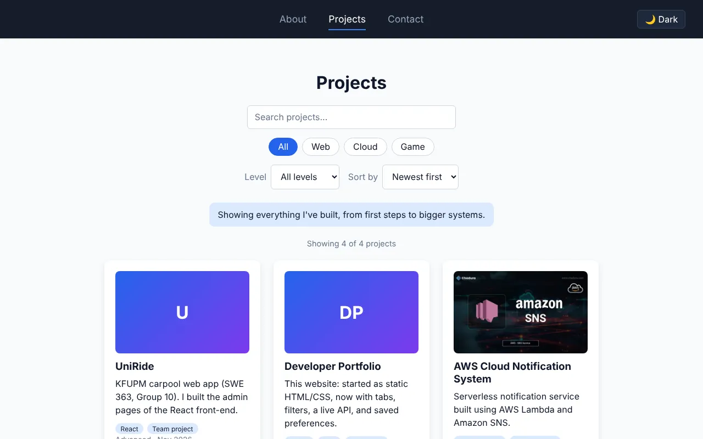

# Bader | Developer Portfolio (Assignment 3)

**Live demo:** [https://202358650.github.io/202358650-BaderAl-Ghamdi-assignment3/](https://202358650.github.io/202358650-BaderAl-Ghamdi-assignment3/)



---

## Project Description

This is Assignment 3 of my personal developer portfolio. It builds on [Assignment 2](https://github.com/202358650/202358650-BaderAl-Ghamdi-assignment2) (tabs, live search, dark mode, basic form) and adds:

- A **quote of the day** loaded from an external API
- A project list you can **search, filter, and sort** together
- A **contact form** with a rule for each field
- A **time-on-site timer**
- **Performance** improvements (WebP images, lazy loading, deferred script)

It uses plain HTML, CSS, and JavaScript. There is no framework and no build step.

---

## Features

| Feature | What it does |
|---------|--------------|
| **Quote of the day (API)** | The About page shows a quote from the [DummyJSON Quotes API](https://dummyjson.com/docs/quotes). It is saved for the day, so the API is called at most once a day. If the request fails, a friendly message and a **Try again** button appear. |
| **Search + filter + sort** | Search text, a category (All / Web / Cloud / Game), a level (Beginner / Advanced), and a sort order (newest, oldest, A–Z) all work together. A results count, an empty-state message, and a **Reset filters** button appear when needed. |
| **Level-based message** | Choosing *Beginner* or *Advanced* shows only those projects, with a different description above them. |
| **Contact form validation** | Name (2+ characters), email (`name@domain.tld`), message (20–500 characters, with a live counter). Errors appear under each field and clear once fixed. The button is disabled while "sending". |
| **Dark / light mode** | Saved in `localStorage`. On a first visit it follows the system setting, with no white flash. |
| **Linkable tabs** | Each tab has its own URL (e.g. `#/projects`), so refresh and the Back button work. Filters are remembered too. |
| **Timer** | The footer shows how long you have been on the site. |

---

## How to Use

| Feature | How |
|---------|-----|
| Switch sections | Click **About / Projects / Contact** in the top bar. |
| Find a project | In **Projects**, type in the search box, click a category, or change **Level** / **Sort by**. Click **Reset filters** to clear. |
| Send a message | Open **Contact**, fill in the fields, and click **Send Message**. Fix any red messages under the fields. |
| Change theme | Click 🌙 / ☀️ in the top-right corner. |

> The contact form is front-end only. Sending is simulated.

---

## Setup Instructions (Run Locally)

**Requirements:** a modern browser. An internet connection is needed for the quote. Nothing to install.

1. Clone the repository:
   ```bash
   git clone https://github.com/202358650/202358650-BaderAl-Ghamdi-assignment3.git
   cd 202358650-BaderAl-Ghamdi-assignment3
   ```
2. Run it with **one** of these options:
   - **VS Code:** use the **Live Server** extension → right-click `index.html` → **Open with Live Server**.
   - **Terminal:** `python3 -m http.server 8000`, then open <http://localhost:8000>.
   - Or just double-click `index.html`.

**Deploy:** repo **Settings → Pages → Deploy from a branch → `main` / root**.

---

## Project Structure

```text
202358650-BaderAl-Ghamdi-assignment3/
├── README.md
├── index.html
├── css/styles.css
├── js/script.js
├── assets/images/        # WebP images
├── docs/
│   ├── ai-usage-report.md
│   └── technical-documentation.md
└── .gitignore
```

---

## Performance

- PNG → **WebP**, resized to display size: project images 40 KB → 14 KB, screenshot 214 KB → 37 KB.
- `loading="lazy"` and `width`/`height` on images; `defer` on the script.
- The quote is cached for the day, so there are no repeat API calls.
- No frameworks, libraries, or web fonts.
- Removed unused files from A2 (`.idea/`, `.DS_Store`, old PNGs).
- CSS variables handle dark mode without duplicated rules.

**Lighthouse (desktop):** Performance __ · Accessibility __ · Best Practices __ · SEO __ <!-- TODO -->

---


## Author

**Bader Alghamdi**, Student ID: 202358650
